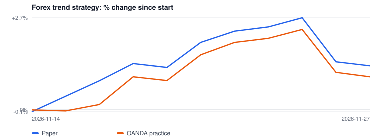

# 📈 Forex trend strategy

Updated Sat 14 Nov 2026, 17:32 UTC · **practice and simulated money only, no real trades**

> Follows the trend of each of the 7 major currency pairs: 7 fixed signals per pair (price vs its 20/50/100/200-day averages, 30/90/180-day momentum). Long when the trend is up, short when it's down, sized to a 10% volatility target. Trades when a pair's signal changes.

## At a glance

| | Paper (simulated $) | OANDA practice (demo £) |
|---|---:|---:|
| **Account value** | **$9,994.68** | **£100,000.00** |
| Today | ⚪ first day | ⚪ first day |
| Since start | 🔴 −0.05% (since 2026-11-14) | ⚪ +0.00% (since 2026-11-14) |
| Trading costs paid | $5.32 | in the OANDA fill prices |
| Go-live check | ⏳ waiting for data (0.0 of 26 weeks) | |

## What it's betting on

Each position is a bet on a currency rising (↑) or falling (↓) against the US dollar. Size is the position as a multiple of the account value.

| Currency | Bet vs USD | Size |
|---|---|---:|
| EUR | ↓ falls | 0.72× |
| GBP | ↓ falls | 0.70× |
| JPY | ↓ falls | 0.34× |
| AUD | ↓ falls | 0.50× |
| CAD | ↓ falls | 0.75× |
| CHF | ↓ falls | 0.51× |
| NZD | ↓ falls | 0.47× |

Total exposure: **4.00×** the account value.

## Today's trades

- **Paper:** bought USD/CAD, USD/CHF, USD/JPY · sold AUD/USD, EUR/USD, GBP/USD, NZD/USD
- **OANDA practice:** no trades (market closed)

## Performance

Daily history (change since start, latest first)

| Date | Paper | OANDA practice |
|---|---:|---:|
| 2026-11-14 | −0.05% | +0.00% |

## Go-live check: ⏳ waiting for data

| | Check | Detail |
|---|---|---|
| ⏳ | Long enough on OANDA practice | 0.0 of 26 weeks |
| ⏳ | Making money after costs | practice return +0.00% after all costs |
| ⏳ | Real costs close to the assumptions | no filled practice orders yet |
| ⏳ | Practice matches paper | paper account has too little history |
| ✅ | Runs reliably (no misses, mismatches, halts) | missed weekdays 0; mismatches 0; order problems 0; not halted |
| ✅ | Losses stay limited | worst fall 0.0% (limit -20%) |

---
⚠️ The backtest found **no edge** for this strategy after costs (see [results/RESEARCH.md](../results/RESEARCH.md)). These accounts are here to check that on live data. Don't fund it. · [Overview](../REPORT.md)
