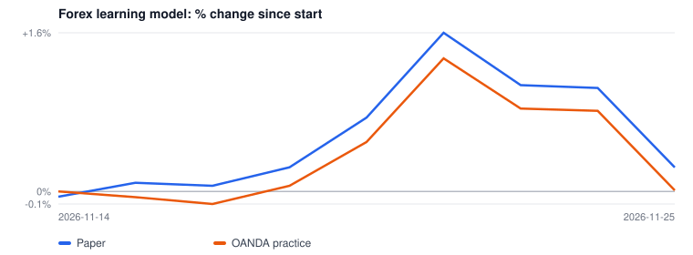

# Forex learning model: paper report

Updated 2026-11-14 16:34 UTC · week of 2026-11-13 · **simulated: no real money**

**Strategy:** LightGBM retrained every week on all past weeks (24 inputs per currency: momentum, trend, volatility,
interest carry, risk sentiment). Long the 3 currencies predicted strongest for next week, short the 3 weakest, 10%
volatility target. Backtest: **no edge out of sample** ([results/MODEL.md](../results/MODEL.md)). This account checks
that on live data.

| | |
|---|---|
| Account value | **$9,994.73** |
| Change since start (2026-11-14) | -0.05% |
| Trend paper account | not enough overlapping days yet |
| Weeks traded | 1 |
| Trading costs / financing / carry | $5.23 / $0.02 / $-0.02 |

## Live prediction scorecard
Weeks scored: **0** · mean IC: n/a (backtest 2015–26: +0.014;
useful is about 0.05) · t-stat: n/a · weeks the longs beat the shorts:
n/a%.
Fewer than ~26 scored weeks says almost nothing either way.

## Current exposure (+ = long that currency vs USD)
| Currency | Exposure (x equity) |
|---|---:|
| EUR | +0.67x |
| GBP | -0.67x |
| JPY | +0.67x |
| AUD | -0.67x |
| CAD | -0.67x |
| CHF | -0.00x |
| NZD | +0.67x |

Most-used inputs in the latest fit: carry (172), vol_ratio (171), vol_level (161), mom_5 (128), carry_x_vixchg (118), dist_sma50 (117), rsi14 (117), mom_20 (111), dist_sma200 (111), mom_250 (101)

